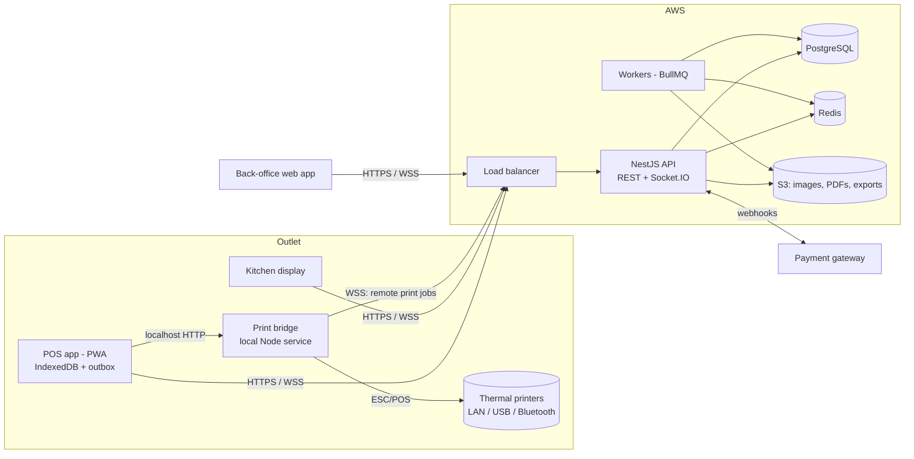
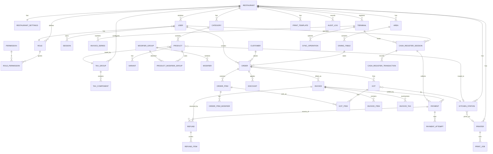

# Restaurant POS & Billing (India) — Requirements, Architecture and Roadmap

## Context

The goal is an original, commercial-grade restaurant POS and billing product for India, comparable in function to Petpooja's billing product. Version 1 covers billing and POS only: no inventory, CRM, loyalty, payroll, HR, franchise or subscription billing.

The workspace `/Users/kudnan/Documents/projects/gitlabProject/billing-software` is empty and is not yet a git repository. Node 22, pnpm 11, Docker, Postgres 14 and Redis 7 are installed locally.

This document is the "first response" you asked for: research, requirements, stack, architecture, data model, folder structure and roadmap. No code is written until you approve it.

---

## 1. Petpooja feature analysis

Source: the Petpooja homepage and 12 product pages (POS, billing, menu, KDS, reports, offline POS, captain app, pricing, fine-dine, QSR), plus Petpooja's own blog. The product pages are marketing copy and there is no public help centre, so screen-level detail comes from vendor-written blog posts.

| Area | What Petpooja does | What we take from it |
|---|---|---|
| Billing | "3-click billing": take order, print KOT, print bill. Keyboard view and touch view. Item short codes, with quantity typed before the code ("3 MT"). Favourites screen. | Both a keyboard path and a touch path on one screen; short codes; favourites. |
| Order types | Dine-in, takeaway with tokens, delivery. Aggregator orders land in the same screen. | Dine-in, takeaway (token numbers), delivery. Aggregators are out of scope. |
| Split and merge | Split by equal share, by item or by custom amount; tax is recalculated per share. Splitting affects the bill only; the kitchen still sees one set of KOTs. A settled bill cannot be merged. | Same rules. |
| Discounts and voids | Order-level and item-level discounts, capped by user rights. Complimentary items and cancellations need a preset reason. Reprints are counted. | Same; reasons and counts feed an audit report. |
| Tables | Areas, each with its own layout (and optionally its own menu and tax). Move, merge and split tables with the running order following the guests. | Areas and floor layout, transfer, merge. Per-area menus are deferred. |
| KOT and KDS | KOTs routed to station printers by menu mapping. KDS shows tickets plus an aggregated item list; staff mark food ready. KOT changes are logged. KDS is a paid add-on. | Station routing, KDS with four statuses, modification log. |
| Menu | Categories, variations, add-ons, combos, per-item available times, on/off toggle from the POS. | Categories, variants, modifier groups, availability toggle. Combos and timed availability are deferred. |
| GST | Menu cannot be used until GST slabs are set or the outlet declares itself unregistered. Item-wise tax report, HSN report, category-wise tax split. | Same onboarding gate and the same three reports. |
| Payments | Cash with change calculation, card, UPI QR (dynamic QR on the bill), split tender, credit. A bill cannot settle with an unpaid balance. | Same, with a gateway adapter interface. Customer credit ledger is deferred. |
| Day end | Day End Summary, bill settlement report, sales by biller, denomination entry, manual day close for outlets open past midnight. | Cash register sessions plus a configurable business-day cut-off. |
| Roles | Per-user rights, including "modify after settlement", discount caps and refund rights. | Permission-based RBAC with these as named permissions. |
| Platforms | Android app, a desktop app, and a "Local" edition with an on-premise bridge server. | See offline design in section 4. |
| Offline | Bills, KOTs and day-end reports work for up to 5 days offline, then sync automatically. | Same target. |

Not confirmed by any Petpooja source, so designed from general restaurant practice instead: hold/park order, refund steps, printer paper widths and interfaces, table colours on the core floor view, and how sync conflicts are resolved.

---

## 2. Product requirements

### Users and permissions
Five seeded roles, each a bundle of permissions that the owner can edit:

| Role | Typical rights |
|---|---|
| Owner | Everything, including settings, users, tax setup and all reports |
| Manager | Menu, tables, reports, refunds, cancel settled bills, approve discounts above cap |
| Cashier | Bill, settle, hold, reprint, open and close their own register |
| Captain | Take table orders and fire KOTs; cannot settle |
| Kitchen | KDS only |

Sensitive actions are separate permissions: `order.cancel`, `invoice.cancel_after_settlement`, `refund.create`, `discount.above_cap`, `kot.cancel_item`, `register.adjust`, `report.view`, `settings.manage`. A cashier who lacks one can get a manager to approve it by PIN at the terminal.

### Functional requirements by module

1. **Authentication.** Email and password login, logout, password reset by emailed link, a 4–6 digit PIN for fast cashier switching on a shared terminal, session list with revoke.
2. **Dashboard.** Today's sales, order count, average order value, payment-mode split, recent transactions, register status. Updates live.
3. **Menu.** Categories (ordered), products with image, short code, veg/non-veg/egg mark, variants, modifier groups (min/max selections), price per variant, tax group, HSN/SAC code, kitchen station, availability toggle.
4. **POS billing.** Category grid and search by name or short code; dine-in, takeaway, delivery; quantity, notes, modifiers; item and bill discounts (percent or amount, with reason); hold and resume; split (equal, by item, by amount); merge; cancel with reason; refund (full or partial); reprint with count.
5. **Tables.** Areas, drag-and-drop floor layout, table states (free, occupied, bill printed, blocked), transfer, merge, table-wise running order.
6. **KOT.** One KOT per station per "fire"; only new or changed items are sent; statuses pending → preparing → ready → completed; cancel-item KOTs; reprint; KDS screen per station with live updates and an item summary.
7. **GST billing.** See "GST rules" below.
8. **Payments.** Cash (with change), UPI, card, split tender, gateway-initiated UPI QR, payment status including failed, refunds linked to the original payment, daily reconciliation of recorded versus gateway-settled amounts.
9. **Printers.** 58 mm and 80 mm ESC/POS thermal printers over network, USB and Bluetooth; receipt and KOT templates; automatic KOT printing; job queue with retry and a fallback printer.
10. **Reports.** Daily and monthly sales, orders, item-wise, category-wise, GST (rate-wise, HSN-wise), payments, discounts, refunds and cancellations, cashier-wise. Export to PDF, CSV and Excel.
11. **Cash register.** Open with float, cash in and cash out with reason, close with counted cash (by denomination), expected versus actual, variance, history per cashier.
12. **Offline POS.** See section 4.

### GST rules the system will implement
These are my working understanding and I will re-check each against current CBIC rules during Phase 5. A chartered accountant should review the invoice format before commercial launch.

- **No hardcoded rates.** Tax groups are data: a group (for example "GST 5%") has components with rates. Restaurants normally charge 5% without input tax credit under SAC 9963; some premises charge 18%. Both are just configuration.
- **CGST + SGST or IGST.** Same state as the place of supply gives CGST and SGST in equal halves; a different state gives IGST. The restaurant's state code and the customer's state decide it.
- **Unregistered and composition outlets.** A setting switches the document to a "Bill of Supply" with no tax lines.
- **Inclusive and exclusive pricing.** Set per restaurant with a per-product override. Inclusive prices are back-calculated to a taxable value.
- **Discounts** reduce the taxable value before tax. Bill-level discounts are spread across lines in proportion.
- **Invoice numbers** are consecutive, unique within a financial year (April to March), at most 16 characters, and are never reused or deleted. Each terminal gets its own series (for example `A1/2627/000123`), which is what makes offline numbering safe.
- **Cancellations and refunds** never delete or edit an invoice. A cancellation marks it cancelled with a reason; a refund issues a credit note with its own series, linked to the original invoice.
- **Invoice content.** Business name, address, GSTIN, FSSAI number, invoice number and date, customer name and GSTIN (for B2B), line items with HSN/SAC, taxable value, tax per component, round-off, total, and amount in words.
- **Service charge** is supported but off by default and is shown as optional, in line with the consumer-protection guidelines.
- **Money** is stored as integer paise; tax rates as basis points. Tax is rounded per line per component; the bill total has a configurable round-off line.
- **Out of scope for v1:** e-invoicing (IRN/QR from the government portal) and GSTR filing exports. The schema leaves room for IRN fields.

### Order numbering and renumbering after delete
Requested behaviour: with orders 1, 2, 3, deleting order 2 should leave 1, 2 rather than 1, 3.

An order carries two different numbers, and they are treated differently:

| Number | What it is | After a delete |
|---|---|---|
| **Order number** | The internal running number shown on the POS, order list and KOT | Renumbered, so the sequence stays gapless |
| **Invoice number** | The legal GST number printed on the bill | Never changed or reused |

Rules:
- **Unbilled orders can be deleted** (permission `order.delete`, reason required). The orders after it in the same series are renumbered automatically: 1, 3 becomes 1, 2.
- **A setting controls this:** `Renumber orders after delete` = automatic (default) / manual / off. In manual mode the owner gets a "Reset order numbers" button in settings and on the order list, which closes the gaps on demand.
- **Order counter reset:** the order number restarts daily, each financial year, or never (setting), and the owner can reset it by hand to start again from 1.
- **Billed orders cannot be deleted or renumbered.** Once an invoice exists, the order can only be cancelled or refunded: it stays in the list marked cancelled, and its invoice number stays in the sequence. Renumbering issued invoices would break the GST rule on consecutive invoice numbers and would let sales be hidden, so the system does not offer it. *(Changed on 2026-11-22 at the owner's request: the owner can now erase or reopen a billed order. See "Owner corrections" in `DEVELOPMENT_STATUS.md`.)*
- **Traceability:** the database row keeps its permanent UUID; only the display number changes. Each delete and each renumber is written to the audit log with the old and new numbers.
- **Side effects to expect:** a KOT already printed keeps the old order number on paper; the POS and KDS show the new one. Renumbering runs per terminal series, and for offline terminals it runs after sync.

Implementation: `orders.order_number` is a mutable display column, unique per `(restaurant_id, series, business_date)` with a deferrable constraint; `OrdersService.delete()` deletes and renumbers in one transaction with a lock on the series; `POST /orders/renumber` backs the manual button. Covered by tests for delete-and-renumber, concurrent order creation during renumber, and refusal on billed orders.

### Non-functional requirements
- Adding an item on the POS responds in under 100 ms (local state first, server after).
- All money-changing endpoints are idempotent.
- Every sensitive action writes an audit log entry with user, terminal, before and after.
- Daily automated database backups with point-in-time recovery; documented restore drill.

---

## 3. Recommended technology stack

Your proposed stack is sound and I recommend keeping it. Additions and the reasons:

| Concern | Choice | Why |
|---|---|---|
| Monorepo | pnpm workspaces + Turborepo | Cached builds across five apps and shared packages |
| Frontend | Next.js (App Router), React, TypeScript, Tailwind | As requested |
| Client data | TanStack Query for server state, Zustand for the POS cart | Cart must be instant and survive refresh |
| Offline store | Dexie (IndexedDB) + service worker (Serwist) | Durable local orders and an outbox queue |
| Backend | NestJS, TypeScript | As requested |
| Validation | Zod schemas in a shared package, used by NestJS (`nestjs-zod`) and by forms | One definition for API, Swagger and UI; replaces class-validator |
| Database | PostgreSQL 16, Prisma | As requested; run in Docker rather than the local Postgres 14 |
| Cache and queues | Redis + BullMQ | Print jobs, sync retries, report exports, email |
| Real-time | Socket.IO through a NestJS gateway with the Redis adapter | Rooms per restaurant and station; reconnect handling built in |
| Passwords | Argon2id | Current recommended hash |
| PDF and Excel | pdfmake (server-side) and exceljs | No headless browser to operate |
| Printing | A small local Node "print bridge" speaking ESC/POS | Browsers cannot reach raw thermal printers reliably |
| Tests | Vitest (unit), Jest + Supertest + Testcontainers (API), Playwright (end-to-end) | Real Postgres and Redis in integration tests |
| Infrastructure | Docker; AWS ECS Fargate, RDS Postgres, ElastiCache, S3 + CloudFront; Terraform; GitHub or GitLab CI | Managed services, no servers to patch |

One structural recommendation beyond the stack: put all bill arithmetic in a pure shared package, `billing-core`. The POS uses it to price orders offline; the API uses the same code and is the authority. That keeps business logic owned by the backend without two implementations drifting apart.

---

## 4. System architecture



### Authentication
- Short-lived access token (15 minutes, held in memory) plus a rotating refresh token in an `HttpOnly`, `Secure`, `SameSite=Strict` cookie. Refresh tokens are stored hashed in a `sessions` table, so sessions can be listed and revoked, and reuse of an old token revokes the whole chain.
- Each POS device is registered as a **terminal** and receives its invoice series. Cashier PIN switching issues a short session bound to that terminal.
- A permissions guard checks every route against the user's role permissions; every query is scoped by `restaurant_id`.
- Rate limiting (Redis-backed) on login, PIN, password reset and payment endpoints. Helmet, strict CORS, CSRF protection on the cookie-refresh route.

### Offline design
The POS is an installable PWA that treats the local database as its first write target.

- **Cached locally:** menu, taxes, tables, printers, templates, the terminal's invoice series counter, and the user's permissions.
- **Writes** go to IndexedDB and to an outbox as operations (`order.create`, `order.addItem`, `kot.fire`, `invoice.create`, `payment.record`), each with a client-generated UUID and an idempotency key.
- **Sync:** a background loop pushes the outbox in order to `POST /sync/push` with exponential backoff, and pulls changes from `GET /sync/pull?cursor=`. The server stores each operation ID, so a retry can never create a duplicate order, invoice or payment.
- **Conflicts:** operations on an open order are additive and merge. A settled invoice is immutable. If the server rejects an operation (for example, the table was billed from another terminal), the order is kept, flagged "needs review" and shown to a manager; nothing is silently dropped. The server re-computes totals with `billing-core` and records any mismatch.
- **Invoice numbers** come from the terminal's own series, so two offline terminals cannot collide.

| Works offline | Needs internet |
|---|---|
| Login by PIN on a previously used terminal | First login, password reset |
| Browse menu, create and edit orders | Menu, tax, table and user changes |
| Fire and print KOTs, print bills (through the local bridge) | Kitchen display updates |
| Cash payments; UPI and card recorded as "collected manually" | Gateway UPI QR and payment confirmation |
| Hold and resume, split, discounts within the user's cap | Manager approval from another device |
| The terminal's own register session | Dashboard, reports, exports, refunds |
| | Seeing orders made on other terminals |

The last row is the main limitation of a cloud-hosted design: while offline, terminals in the same outlet do not see each other's orders. Petpooja solves this with an on-premise server. I recommend shipping v1 without one and adding a LAN hub later if outlets with several counters need it.

### Printing
- The **print bridge** is a small Node service installed on the billing counter PC. It listens on `127.0.0.1` with a pairing token, renders templates to ESC/POS, and sends to network printers (TCP 9100), USB printers and paired Bluetooth printers.
- It also keeps a WebSocket to the API so a KOT fired from another device (a captain's phone) prints in the kitchen.
- Every print is a `print_jobs` row with status, attempts and error. On failure it retries, then routes to the station's fallback printer, then raises an alert on the POS. A KOT that could not be printed stays visibly unprinted.
- Without a bridge, the POS falls back to the browser print dialog with 58 mm and 80 mm print stylesheets.
- Android tablets: a companion app wrapping the same bridge protocol is designed for but built after v1.

### Payments
A `PaymentProvider` interface (`createIntent`, `getStatus`, `refund`, `verifyWebhook`) with a manual provider (cash, and UPI/card recorded by the cashier) and one gateway adapter in sandbox mode. Webhooks are verified by signature and de-duplicated by event ID. Reconciliation compares recorded payments against gateway settlements per day.

### Deployment
- Local: `docker compose up` brings up Postgres, Redis, Mailpit (email capture) and MinIO (S3 stand-in).
- AWS: API and workers on ECS Fargate behind a load balancer across two availability zones; RDS Postgres Multi-AZ with automated backups and point-in-time recovery; ElastiCache Redis; S3 with versioning; secrets in Secrets Manager; CloudWatch logs and alarms. Front-end apps as containers on Fargate behind CloudFront.
- Disaster recovery targets: restore within 1 hour, lose at most 5 minutes of data. A restore runbook is part of Phase 9.

---

## 5. Database design

Conventions: UUID primary keys (client-generatable), `restaurant_id` on every tenant table, `created_at` / `updated_at`, soft delete on menu entities only, money in integer paise, enums for statuses.



Key design points:

- **Order versus invoice.** An order is the running tab; an invoice is the legal document. Splitting a bill creates several invoices from one order. Invoice items and invoice taxes are snapshots (name, HSN, rate, amounts), so later menu or tax changes never alter an issued invoice.
- **Immutability.** Issued invoices, payments, refunds and audit logs are append-only; a database trigger blocks updates to their financial columns.
- **Constraints.** Unique `(restaurant_id, series_id, number)` on invoices; unique `idempotency_key` on payments, refunds and sync operations; unique product short code per restaurant; check constraints for non-negative amounts and for refund totals not exceeding the paid amount; a partial unique index so a table has at most one open order.
- **Indexes.** `(restaurant_id, business_date)` on orders, invoices and payments for reports; `(restaurant_id, status)` on orders and KOTs; trigram index on product name for search; `(restaurant_id, created_at)` on audit logs.
- **Business date** is stored on orders and invoices, derived from a configurable day cut-off, so an outlet open past midnight reports correctly.
- **Seed data.** Permissions and the five roles, a demo restaurant with GST tax groups, two areas with tables, three kitchen stations, a sample menu of about 40 items with variants and modifiers, and one owner and one cashier whose passwords come from environment variables.

Migrations are Prisma migrations, plus hand-written SQL migrations for triggers, check constraints, partial indexes and the trigram extension.

---

## 6. Backend architecture

One NestJS application, organised as feature modules; each has a controller (HTTP only), services (business rules), a repository layer over Prisma, and Zod DTOs from the shared package.

Modules: `auth`, `users`, `roles`, `restaurants`, `settings`, `terminals`, `menu` (categories, products, variants, modifiers), `taxes`, `tables`, `orders`, `kot`, `invoices`, `payments`, `refunds`, `cash-register`, `printers`, `reports`, `sync`, `audit`, `files`, `realtime` (gateway), `health`.

Cross-cutting pieces:
- Global Zod validation pipe; a single exception filter returning a consistent error shape with a stable error code.
- JWT guard, permissions guard, tenant scoping via request context.
- Idempotency interceptor reading an `Idempotency-Key` header on all money-changing POST routes.
- Audit interceptor plus explicit audit calls for sensitive actions.
- Structured JSON logging (pino) with request IDs; health and readiness endpoints.
- Swagger generated from the Zod schemas at `/api/docs`.
- Money-changing flows (create invoice, record payment, refund, close register) run in a database transaction; invoice numbers are allocated with a row lock on the series.
- Domain events (`order.updated`, `kot.created`, `kot.statusChanged`, `invoice.paid`, `table.statusChanged`) are published to the Socket.IO gateway and to BullMQ.

REST layout, versioned under `/api/v1`: `/auth/*`, `/users`, `/roles`, `/restaurant`, `/settings`, `/categories`, `/products`, `/modifier-groups`, `/tax-groups`, `/areas`, `/tables`, `/orders` (with `/hold`, `/resume`, `/split`, `/merge`, `/cancel`, `/transfer`), `/kots`, `/invoices` (with `/pdf`, `/reprint`, `/cancel`), `/payments`, `/refunds`, `/registers`, `/printers`, `/print-jobs`, `/reports/*`, `/sync/push`, `/sync/pull`.

---

## 7. Frontend architecture

Three Next.js apps sharing one component library and one API client.

| App | Users | Screens |
|---|---|---|
| `web` (back office) | Owner, manager | Login, dashboard, menu, tables and floor editor, order history, invoices, payments and reconciliation, cash register history, reports, settings (business, tax, printers, templates, terminals), users and roles |
| `pos` | Cashier, captain | PIN login, POS billing, table floor, held bills, settle and split dialogs, register open/close, reprint, sync status |
| `kds` | Kitchen | Station picker, ticket board, item summary |

- **Shared UI package:** buttons, inputs, dialogs, data table with filters, numeric keypad, money input, status badges, empty/loading/error states, toasts. Built on Radix primitives with Tailwind, with a touch size scale for the POS (minimum 48 px targets).
- **POS screen layout:** categories on the left, product grid in the centre, cart and totals on the right, order-type and table selector on top. Totals are computed locally with `billing-core`.
- **Keyboard shortcuts:** `/` or F2 search, quantity-then-code entry, F4 hold, F6 fire KOT, F8 print bill, F9 settle, Esc close dialog. Shown in a help overlay and configurable later.
- **Data flow:** the typed API client is generated from the shared Zod schemas. Back office and KDS use TanStack Query plus socket events to invalidate. The POS reads and writes through a local repository (Dexie) that the sync engine reconciles with the server.
- **Connectivity indicator** in the POS header: online, offline, syncing, with a count of unsynced operations.

---

## 8. Folder structure

```
billing-software/
├─ apps/
│  ├─ api/              NestJS API and workers
│  │  ├─ src/modules/<feature>/{controller,service,repository,events}.ts
│  │  ├─ src/common/    guards, interceptors, filters, pipes
│  │  └─ test/          integration tests
│  ├─ web/              Back office (Next.js)
│  ├─ pos/              POS PWA (Next.js)
│  │  └─ src/offline/   Dexie schema, outbox, sync engine
│  ├─ kds/              Kitchen display (Next.js)
│  └─ print-bridge/     Local Node print service (ESC/POS)
├─ packages/
│  ├─ database/         Prisma schema, migrations, seed
│  ├─ billing-core/     Pure tax, discount, rounding, split and numbering logic
│  ├─ validation/       Zod schemas (DTOs)
│  ├─ types/            Shared types, enums, event names, permission keys
│  ├─ api-client/       Typed REST and socket client
│  ├─ ui/               Component library and Tailwind preset
│  └─ config/           Shared tsconfig, ESLint, Prettier
├─ e2e/                 Playwright tests
├─ infra/
│  ├─ docker/           Dockerfiles, docker-compose.yml
│  └─ terraform/        AWS infrastructure
├─ docs/                PRD, architecture, ER diagram, offline matrix, runbooks
├─ DEVELOPMENT_STATUS.md
├─ turbo.json, pnpm-workspace.yaml, .env.example
```

---

## 9. Development roadmap

Each phase ends with working, tested software and an updated `DEVELOPMENT_STATUS.md`. I will stop for your review at the end of each phase.

| Phase | Deliverable | Done when |
|---|---|---|
| 1. Requirements | This document, saved to `docs/` as PRD and architecture | You approve it |
| 2. Architecture | ER diagram, API outline and offline matrix in `docs/` | Included in this document; expanded as files |
| 3. Foundation | `git init`, monorepo, five apps booting, Docker Compose, Prisma schema and migrations, seed, CI lint/typecheck/test | `docker compose up` and `pnpm dev` start everything; seed loads |
| 4. Auth, settings, menu | Login, reset, sessions, RBAC, restaurant and tax settings, full menu management with images | Owner can configure a restaurant and menu end to end; API tests pass |
| 5. Billing core | `billing-core` with GST tests; orders, discounts, hold, split, merge, cancel; invoices and PDF; payments, split tender, refunds; POS screen | A takeaway order can be billed, paid by split tender, refunded and reprinted; GST tests pass |
| 6. Tables and KOT | Floor editor, table states, transfer, merge; KOT routing, KDS app, live updates | A dine-in order flows table → KOT → KDS → bill in two browsers live |
| 7. Printers, register, reports | Print bridge, templates, job queue and failover; register sessions; all reports and exports; dashboard | Receipt and KOT print on a real or emulated ESC/POS printer; day close balances |
| 8. Offline | PWA, local store, outbox, sync endpoints, conflict handling, indicator | Orders made with the network off sync exactly once when it returns |
| 9. Hardening and deploy | Full end-to-end suite, security review, rate limits, backups and restore runbook, Terraform, production Dockerfiles | Test suite green; staging deployed on AWS |

Test coverage planned: GST calculation (inclusive, exclusive, CGST/SGST, IGST, discount spread, rounding), billing totals, split bill, split payment, refund limits, duplicate payment and duplicate sync submission, invoice number gaps under concurrency, KOT routing and delta logic, offline sync replay and conflict, printer failure and failover.

---

## Decisions I have made that you may want to change

1. **Multi-tenant ready, single outlet.** Every table carries `restaurant_id` so several restaurants can share one deployment later, but v1 has no signup, plans or multi-outlet management.
2. **Cloud server with offline-capable terminals,** not an on-premise server. Consequence: offline terminals in one outlet do not see each other until the connection returns.
3. **Print bridge as a desktop Node service first;** Android companion app designed but built after v1.
4. **Razorpay as the first gateway adapter,** in sandbox mode. Cash and manually recorded UPI/card work without any gateway.
5. **Zod instead of class-validator** for DTOs, so validation is shared with the front end.
6. **Renumbering applies to order numbers only, not GST invoice numbers.** Deleting an unbilled order closes the gap (1, 3 becomes 1, 2). A billed order keeps its invoice number and can only be cancelled. If you meant the invoice number on printed bills should also be renumbered, tell me — I advise against it for GST compliance.
7. **Deferred to after v1:** combos, timed item availability, per-area menus and prices, customer credit ledger, aggregator orders, e-invoicing, UI languages other than English.

## Verification

- `docker compose up -d` then `pnpm install && pnpm db:migrate && pnpm db:seed && pnpm dev` starts the API (with Swagger at `/api/docs`) and the three front-end apps.
- `pnpm test` runs unit tests; `pnpm test:int` runs API tests against real Postgres and Redis containers; `pnpm test:e2e` runs Playwright through login → order → KOT → bill → split payment → refund → register close.
- Offline: Playwright switches the browser context offline, creates and settles orders, goes back online, and asserts each order, invoice and payment exists once on the server with the expected invoice numbers.
- Printing: the bridge is tested against a TCP ESC/POS emulator, including a forced failure to check retry and fallback.
- After each phase I will run the app and walk the new flows in a browser before reporting the phase complete.
